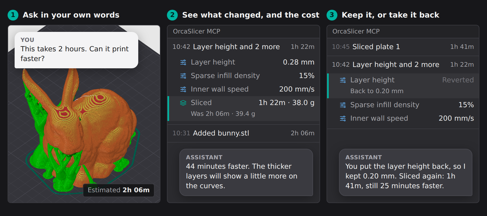

<p align="center">
  <picture>
    <source media="(prefers-color-scheme: dark)" srcset="https://raw.githubusercontent.com/MaxEllis/orcaslicer-mcp/main/docs/images/logo-dark.svg">
    
  </picture>
</p>

<h3 align="center">Ask OrcaSlicer for what you want. See what changed and what it costs. Keep it, or take it back.</h3>

<p align="center">
  <a href="https://pypi.org/project/orcaslicer-mcp/"></a>
  <a href="https://github.com/MaxEllis/orcaslicer-mcp/blob/main/LICENSE"></a>
  <a href="https://lobehub.com/mcp/maxellis-orcaslicer-mcp"></a>
</p>

<p align="center"></p>

OrcaSlicer MCP lets an AI assistant work your OrcaSlicer: change settings, switch presets, load and slice models, and explain the result. It works in the window you already use, and a panel beside the 3D view lists every change with a way to undo it.

## Two ways to run it

| | **OrcaSlicer MCP build** | **Plugin** for OrcaSlicer 2.5 |
|---|---|---|
| **What it is** | OrcaSlicer 2.5 with the assistant's way in built in | An add-on for the OrcaSlicer you already have |
| **The assistant can** | Change settings and presets, load and arrange models, slice, render the plate, manage plates and projects | Read your setup, change settings, switch presets |
| **The panel** | Every change with an undo, plus restore points | Setting and preset changes with an undo |
| **Get it** | [Download](https://github.com/MaxEllis/OrcaSlicer/releases/latest) | [OrcaCloud](https://cloud.orcaslicer.com/p/EXAMPLE) |

Not sure? Start with the plugin, and move to the build when you want the assistant to slice. Either way you also need this package, `orcaslicer-mcp`, which connects your assistant app to OrcaSlicer.

## Get started

**1. Turn on the way in.**
- **Build:** open **Preferences → Remote API**, tick **Enable Remote API** and copy the token.
- **Plugin:** subscribe on OrcaCloud, then in OrcaSlicer's **File → Plugins** install it, tick **Activate** and allow the two permissions it asks for. Copy the token from its **Config** tab.

**2. Add orcaslicer-mcp to your assistant app.** Install [uv](https://docs.astral.sh/uv/getting-started/installation/), then add this to the app's MCP settings:

```json
{
  "mcpServers": {
    "orcaslicer": {
      "command": "uvx",
      "args": ["orcaslicer-mcp"],
      "env": { "ORCA_API_TOKEN": "<your token>" }
    }
  }
}
```

In Claude Desktop, install `orcaslicer-mcp-<version>.mcpb` from the [latest release](https://github.com/MaxEllis/orcaslicer-mcp/releases/latest) instead, and paste the token into its settings.

**3. Ask for something.** If it doesn't connect, see [troubleshooting](docs/troubleshooting.md).

## What you can ask

- *"Why does this take six hours?"* It splits the time by feature: walls, infill, supports.
- *"Try 0.2, 0.28 and 0.32 mm layers and compare."* It slices each one and lays time and filament side by side.
- *"Will this profile work on my printer?"* It checks speeds, temperatures and acceleration against the printer's limits.
- *"What does Wall generator do?"* It answers from OrcaSlicer's own descriptions of its settings.
- *"Put each part on its own plate and slice them."*
- *"Is the print still heating?"* It reads a Klipper or OctoPrint printer, without ever controlling it.

The plugin answers the setting and preset questions. [All 66 tools](docs/tools.md) are listed with examples.

## You stay in charge

- **Every change shows in the panel.** Undo any one, or put the project back to an earlier point (build only).
- **It hears what you change.** Edit something yourself and the assistant is told with its next reply, so it doesn't undo your work.
- **It stays on your computer.** OrcaSlicer listens only locally and wants a token. The assistant can't touch scripts, custom G-code or printer connections unless you allow it in Preferences. [Security details](docs/security.md)

## Privacy policy

orcaslicer-mcp has no backend and collects nothing. It talks to OrcaSlicer and, for the printer tools, your printer, and to nothing else. Your conversation, tool replies included, goes to whichever model your assistant app uses; with a local model nothing leaves your network. [Full privacy policy](docs/privacy.md)

## More

[Tools](docs/tools.md) · [Security](docs/security.md) · [Printers and print history](docs/printer-feedback.md) · [Troubleshooting](docs/troubleshooting.md) · [Development](docs/development.md) · [API reference](https://github.com/MaxEllis/OrcaSlicer/blob/remote-api-250/docs/remote-api/README.md) · [Report a problem](https://github.com/MaxEllis/orcaslicer-mcp/issues)

Free and open source under AGPL-3.0, like OrcaSlicer. If it saves you time, you can [buy me a coffee](https://buymeacoffee.com/maxellis).

<!-- mcp-name: io.github.MaxEllis/orcaslicer-mcp -->
