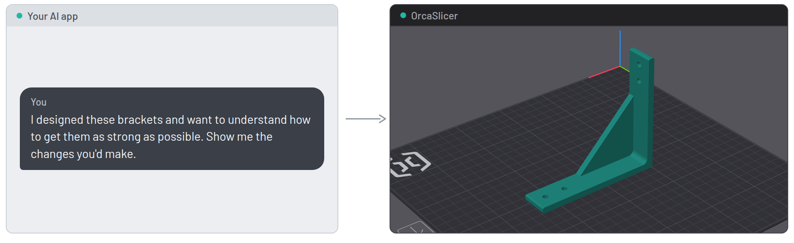

<p align="center">
  <picture>
    <source media="(prefers-color-scheme: dark)" srcset="https://raw.githubusercontent.com/MaxEllis/orcaslicer-mcp/main/docs/brand/logo-horizontal-dark.svg">
    
  </picture>
</p>

<h3 align="center">Work with your AI assistant to get the print you're after, and learn how OrcaSlicer gets you there.</h3>

<p align="center">
  <a href="https://pypi.org/project/orcaslicer-mcp/"></a>
  <a href="https://github.com/MaxEllis/orcaslicer-mcp/blob/main/LICENSE"></a>
  <a href="https://lobehub.com/mcp/maxellis-orcaslicer-mcp"></a>
</p>

OrcaSlicer MCP connects an AI app on your computer to OrcaSlicer. Tell the assistant your goal in plain words. It finds the settings that matter, explains each one, and shows what they cost before you print. The changes happen in the OrcaSlicer window you already use, and the OrcaSlicer MCP panel beside the 3D view lists each one with a way to undo it.

**1. Tell it your goal**

<p align="center"></p>

**2. It changes what matters, and explains why**

<p align="center"></p>

**3. See the trade-off before you print**

<p align="center"></p>

<p align="center"><sub>Shown with the OrcaSlicer MCP build. With the plugin, you press Slice yourself and the assistant reads each slice.</sub></p>

## What you need

- **An AI app on your computer that can use MCP connectors,** such as Claude Desktop, Cursor, VS Code or LM Studio. MCP is how these apps connect to other programs, and `orcaslicer-mcp` is the connector for OrcaSlicer. Chats in a web browser and phone apps can't use it, because the connector runs on your computer.
- **OrcaSlicer 2.5** on Windows, macOS or Linux, with the OrcaSlicer MCP build or the plugin (compared below).
- **About ten minutes.** OrcaSlicer MCP is free. Your AI app uses whatever plan you already have, and with a local model nothing leaves your computer.

## OrcaSlicer MCP build or plugin

| | **OrcaSlicer MCP build** | **OrcaSlicer MCP plugin** |
|---|---|---|
| **What it is** | OrcaSlicer 2.5 with the connection built in | A plugin for stock OrcaSlicer 2.5 |
| Read and change settings | ✓ | ✓ |
| Switch presets | ✓ | ✓ |
| Save, rename and delete presets | ✓ | ✗ |
| Load, move and arrange models | ✓ | ✗ |
| Read the slice you made: time, filament, G-code | ✓ | ✓ |
| Start slices, and compare them side by side | ✓ | ✗ |
| See the plate as a picture | ✓ | ✗ |
| Manage plates and projects | ✓ | ✗ |
| Undo each change in the panel | ✓ | ✓ |
| Restore the project to an earlier point | ✓ | ✗ |
| Read your printer's status | ✓ | ✓ |
| **Your OrcaSlicer** | Replaced, with your printers and presets kept | Stays as it is |
| **Updates** | Offered by the build | Automatic from OrcaCloud |
| **Get it** | [Download](https://github.com/MaxEllis/OrcaSlicer/releases/latest) | [OrcaCloud](https://cloud.orcaslicer.com/p/16d116a6bc41) or the [latest release](https://github.com/MaxEllis/orcaslicer-mcp/releases/latest) |

The trade-off: the build can do everything but replaces your OrcaSlicer. The plugin keeps your OrcaSlicer: it works with settings and presets, and reads each slice you make, but it can't slice or move models itself. To run the build next to stock OrcaSlicer, use its portable Windows zip or Linux AppImage. A plugin installed from a downloaded file doesn't update itself; your assistant tells you when a newer one is out. Install the newer file the same way; OrcaSlicer then turns the plugin off and asks for its permissions again, so click **Yes** and tick **Activate** again. The plugin's source code is in [`plugin/`](plugin/).

## Get started

**1. Turn on the connection in OrcaSlicer.**
- **Build:** open **Preferences → Remote API** and tick **Enable Remote API**.
- **Plugin:** open OrcaSlicer's main menu (the icon beside **File**) → **Plugins**, then install it one of two ways:
  - **From OrcaCloud:** subscribe on [OrcaCloud](https://cloud.orcaslicer.com/p/16d116a6bc41), then install OrcaSlicer MCP from the list.
  - **From a downloaded file:** download `orcaslicer_mcp_plugin.py` from the [latest release](https://github.com/MaxEllis/orcaslicer-mcp/releases/latest). Click the arrow beside **Install plugin** and choose **Install local plugin**. The first time, this only renames the green button, so click **Install local plugin** again and pick the file.

  Tick **Activate**. OrcaSlicer then shows **Plugin permissions**: network access to `127.0.0.1`, which means this computer only; permission to create a thread, which keeps the connection running; and read access to OrcaSlicer's own temporary `orcaslicer_model` folder, where it saves the G-code of each slice. Choose **Yes**; **No** stops the plugin. The plugin's panel then opens beside the 3D view and walks you through step 2. Use one install or the other: in the build, the plugin stays off.

**2. Add the connector to your AI app.** Every app runs the connector with [uv](https://docs.astral.sh/uv/getting-started/installation/), a small free tool, so install it once: `curl -LsSf https://astral.sh/uv/install.sh | sh` on macOS and Linux, or `irm https://astral.sh/uv/install.ps1 | iex` in PowerShell on Windows. Then:
- **Claude Desktop:** download `orcaslicer-mcp-<version>.mcpb` from the [latest release](https://github.com/MaxEllis/orcaslicer-mcp/releases/latest), and open it. Its token field stays empty.
- **Other apps (Cursor, LM Studio and the like):** add this to the app's MCP settings:

  ```json
  {
    "mcpServers": {
      "orcaslicer": {
        "command": "uvx",
        "args": ["orcaslicer-mcp"]
      }
    }
  }
  ```

  VS Code reads the same entry from `.vscode/mcp.json` under `servers` instead of `mcpServers`, with `"type": "stdio"` added. No token is needed: the connector finds OrcaSlicer on the same computer by itself. The plugin's panel and Config tab have a one-click install for Cursor and VS Code and a ready command for Claude Code and Codex. If OrcaSlicer was started with its own settings folder (`--datadir`), add `"env": { "ORCA_DATADIR": "<that folder>" }`. For the build on another computer, set `ORCA_API_URL` and `ORCA_API_TOKEN` ([troubleshooting](docs/troubleshooting.md)).

**Optional: the agent skill.** It teaches Claude Code, Codex and other agents how to work with these tools (where to start, which settings to check first, the traps). In Claude Code: `/plugin install orcaslicer-mcp --marketplace MaxEllis/orcaslicer-mcp`. For other agents, copy the [`skills/orcaslicer-mcp`](skills/orcaslicer-mcp) folder into `~/.agents/skills`. It is instructions only and runs no code.

**3. Check it works.** With OrcaSlicer open, ask *"Which printer and filament is OrcaSlicer set up for?"* The answer should name your printer and filament presets. If it can't connect, or your app warns about too many tools, see [troubleshooting](docs/troubleshooting.md).

## You stay in charge

- **Every change shows in the OrcaSlicer MCP panel.** Undo any one there, or put the project back to an earlier point (build only). OrcaSlicer's own Ctrl+Z (⌘Z on a Mac) undoes model edits, not settings, so use the panel to take a setting back. Closed the panel on the build? **View → OrcaSlicer MCP panel** brings it back.
- **It knows what you changed.** When you edit something yourself, the assistant is told with its next reply, so it doesn't undo your work.
- **It stays on your computer.** OrcaSlicer only accepts connections from this computer, and each one needs the token. [Security details](docs/security.md)
- **Scripts and G-code stay locked.** The assistant can't touch scripts, custom G-code or printer connections. With the build, tick **Allow script, G-code and connection edits** in OrcaSlicer's **Preferences → Remote API**, then ask again. Only that box allows it, and no assistant or API call can tick it. With the plugin it never can.

## Privacy policy

orcaslicer-mcp has no backend and collects nothing. It talks to OrcaSlicer and, for the printer tools, your printer, and to nothing else. Your conversation, tool replies included, goes to whichever model your assistant app uses; with a local model nothing leaves your network. [Full privacy policy](docs/privacy.md)

## More

[Tools](docs/tools.md) · [Security](docs/security.md) · [Printers and print history](docs/printer-feedback.md) · [Troubleshooting](docs/troubleshooting.md) · [Development](docs/development.md) · [API reference](https://github.com/MaxEllis/OrcaSlicer/blob/remote-api-250/docs/remote-api/README.md) · [Report a problem](https://github.com/MaxEllis/orcaslicer-mcp/issues)

Free and open source under AGPL-3.0, like OrcaSlicer. If it saves you time, you can [buy me a coffee](https://buymeacoffee.com/maxellis).

<!-- mcp-name: io.github.MaxEllis/orcaslicer-mcp -->
