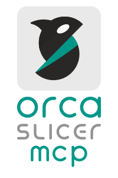

<p align="center">
  <picture>
    <source media="(prefers-color-scheme: dark)" srcset="https://raw.githubusercontent.com/MaxEllis/orcaslicer-mcp/main/docs/images/logo-dark.svg">
    
  </picture>
</p>

<h3 align="center">Tell your AI assistant what the print needs. It finds the OrcaSlicer settings that matter, says why, and shows what they cost before you print.</h3>

<p align="center">
  <a href="https://pypi.org/project/orcaslicer-mcp/"></a>
  <a href="https://github.com/MaxEllis/orcaslicer-mcp/blob/main/LICENSE"></a>
  <a href="https://lobehub.com/mcp/maxellis-orcaslicer-mcp"></a>
</p>

<p align="center"></p>

You talk to the assistant in your usual AI app, in plain words. It makes the changes in OrcaSlicer, in the window you already use: settings, presets, models, slicing. A panel beside the 3D view lists every change it makes, with a way to undo each one.

## Two ways to run it

| | **OrcaSlicer MCP build** | **Plugin** for OrcaSlicer 2.5 |
|---|---|---|
| **What it is** | OrcaSlicer 2.5 with the assistant's way in built in | An add-on for the OrcaSlicer you already have |
| **The assistant can** | Change settings and presets, load and arrange models, slice, render the plate, manage plates and projects | Read your setup, change settings, switch presets |
| **The panel** | Every change with an undo, plus restore points | Setting and preset changes with an undo |
| **Get it** | [Download](https://github.com/MaxEllis/OrcaSlicer/releases/latest) | [OrcaCloud](https://cloud.orcaslicer.com/p/EXAMPLE), or the `.py` file on this repo's [latest release](https://github.com/MaxEllis/orcaslicer-mcp/releases/latest) |

Either way you also need this package, `orcaslicer-mcp`, which connects your assistant app to OrcaSlicer.

## Get started

**1. Turn on the way in.**
- **Build:** open **Preferences → Remote API**, tick **Enable Remote API** and copy the token.
- **Plugin:** subscribe on OrcaCloud and install it from OrcaSlicer's **File → Plugins**, or there choose **Install local plugin** (the arrow beside **Install plugin**) and pick the downloaded file. Tick **Activate** and allow the two permissions it asks for, then copy the token from its **Config** tab. Use one install or the other: each keeps its own token.

**2. Add orcaslicer-mcp to your assistant app.** Install [uv](https://docs.astral.sh/uv/getting-started/installation/), then add this to the app's MCP settings:

```json
{
  "mcpServers": {
    "orcaslicer": {
      "command": "uvx",
      "args": ["orcaslicer-mcp"],
      "env": { "ORCA_API_TOKEN": "<your token>" }
    }
  }
}
```

In Claude Desktop, install `orcaslicer-mcp-<version>.mcpb` from the [latest release](https://github.com/MaxEllis/orcaslicer-mcp/releases/latest) instead, and paste the token into its settings.

**3. Ask for something.** If it doesn't connect, see [troubleshooting](docs/troubleshooting.md).

## What you can ask

Goals, in your own words, the way you'd ask a friend who knows OrcaSlicer:

- *"This lid has to press onto a 40 mm jar. What do I change so it fits first time?"*
- *"I designed these brackets and want to understand how to get them as strong as possible. What suggestions would you make?"*
- *"It's going on a car dashboard. Will PLA survive, and what should I change if I use PETG?"*
- *"The top of this box looks rough. How do I get it smooth?"*
- *"Why does this take six hours, and what can I do about it?"*
- *"Is my print still heating?"* It reads a Klipper or OctoPrint printer, without ever controlling it.

The plugin handles the questions answered by settings and presets. [All 66 tools](docs/tools.md) are listed with examples.

## You stay in charge

- **Every change shows in the panel.** Undo any one, or put the project back to an earlier point (build only).
- **It hears what you change.** Edit something yourself and the assistant is told with its next reply, so it doesn't undo your work.
- **It stays on your computer.** OrcaSlicer listens only locally and wants a token. The assistant can't touch scripts, custom G-code or printer connections unless you allow it in Preferences. [Security details](docs/security.md)

## Privacy policy

orcaslicer-mcp has no backend and collects nothing. It talks to OrcaSlicer and, for the printer tools, your printer, and to nothing else. Your conversation, tool replies included, goes to whichever model your assistant app uses; with a local model nothing leaves your network. [Full privacy policy](docs/privacy.md)

## More

[Tools](docs/tools.md) · [Security](docs/security.md) · [Printers and print history](docs/printer-feedback.md) · [Troubleshooting](docs/troubleshooting.md) · [Development](docs/development.md) · [API reference](https://github.com/MaxEllis/OrcaSlicer/blob/remote-api-250/docs/remote-api/README.md) · [Report a problem](https://github.com/MaxEllis/orcaslicer-mcp/issues)

Free and open source under AGPL-3.0, like OrcaSlicer. If it saves you time, you can [buy me a coffee](https://buymeacoffee.com/maxellis).

<!-- mcp-name: io.github.MaxEllis/orcaslicer-mcp -->
