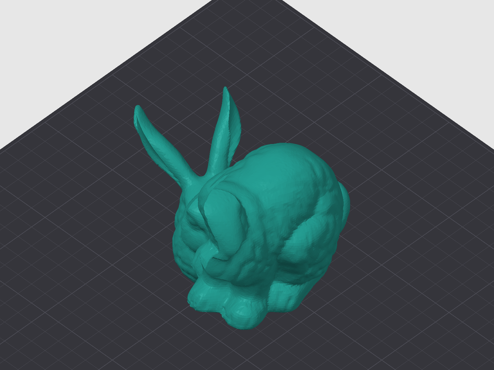
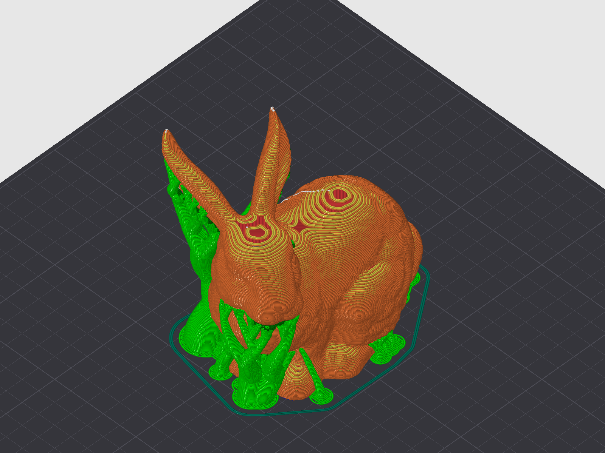

# Tools

68 tools, plus three ready-made prompts (`slice-a-model`, `optimize-print-time`, `edit-preset-safely`) and the settings reference as MCP resources.

| | | |
|---|---|---|
| **Settings** | Read and change any of OrcaSlicer's settings while it runs, for the plate, one object, or a band of layers; reading named settings also says what each one means, and one can be put back to its saved preset value. | `get_config` `set_config` `find_config_keys` `set_layer_height` `set_height_range` `set_object_config` |
| **Knowing what they mean** | Look settings up in OrcaSlicer's own labels and tooltips, and check a profile against your printer's physical limits before printing. | `describe_setting` `search_settings` `compare_settings` `consult` `check_profile_physics` |
| **Presets** | Switch, edit, save, rename and delete presets, and choose the filament preset of one slot on a multi-filament printer. | `list_presets` `select_preset` `get_preset_config` `edit_preset` `save_preset` `rename_preset` `delete_preset` |
| **Filament slots** | See each slot's preset, type, vendor, colour and unsaved edits in one read; point one slot at a preset, keeping its colour; write or save one slot's preset without moving the slots that share it; read per-filament settings one value per slot. | `get_filament_slots` `set_filament_slot_preset` `set_config` (`filament_slot`) `save_preset` (`filament_slot`) `get_config` (`by_slot`) |
| **Models** | Load STL, OBJ, 3MF and STEP files, then move, rotate, scale, duplicate, arrange and auto-orient them. | `load_model` `list_objects` `transform_object` `duplicate_object` `delete_object` `arrange_plate` `auto_orient` `check_placement` `diagnose_plate` |
| **Slicing** | Slice, read time, filament and OrcaSlicer's warnings, split the result by feature, and compare several settings in one go. | `slice` `slice_and_wait` `apply_and_slice` `get_slice_status` `cancel_slice` `get_slice_breakdown` `compare_slices` `get_slice_warnings` `get_gcode` `save_gcode` |
| **Seeing the plate** | Get the plate as a picture, or as a short description of how each part stands, where support goes and where the seams sit. | `render_plate` `describe_plate` |
| **Plates** | Build a project with several plates, one part per plate, each sliced on its own. | `list_plates` `add_plate` `select_plate` `delete_plate` `move_object_to_plate` |
| **Projects** | Save, open and start projects as the File menu does, browse and tidy project files, and see whether there is something to save. | `save_project` `open_project` `new_project` `get_project` `list_recent_projects` `open_recent_project` `forget_recent_project` `browse_projects` `move_project_file` `delete_project_file` |
| **Your printer** | Read what a Klipper or OctoPrint printer is doing, wait for a print to reach a stage, list past jobs, and check the profile matches the printer: its Klipper limits, or on a Bambu Lab printer that each filament's slot preset matches what its AMS tray holds. Read-only. | `get_printer_status` `wait_for_printer` `list_print_history` `check_printer_match` |
| **Learning from prints** | Record each slice with its settings, match it to how the print turned out, and recall that next time. | `recall_prints` `remember` |

The rest: `get_status`, `get_job_status` and `watch_events` report on OrcaSlicer and what it is doing; `get_printer_slots` reads the printer's filament trays (a Bambu Lab printer's AMS through OrcaSlicer's own connection, or an Elegoo Centauri Carbon 2's CANVAS) and `get_filament_slot_mapping` says which tray each filament of the plate will print from and whether it holds what the slot's preset says; `set_filament_slot_mapping` sets that mapping on the CANVAS.

## What the assistant sees

<table>
  <tr>
    <td width="50%"></td>
    <td width="50%"></td>
  </tr>
  <tr>
    <td colspan="2" align="center"><sub><code>render_plate</code>, before and after slicing.</sub></td>
  </tr>
</table>

## Where the time goes

`get_slice_breakdown` returns what OrcaSlicer's preview legend shows, as numbers the assistant can compare and act on:

```
role                    time      share   filament   mean flow
inner_wall              5m 41s    30.8%     6.43 g    16.0 mm3/s
outer_wall              3m 19s    18.0%     3.20 g    13.6 mm3/s
sparse_infill           3m 07s    17.0%     3.57 g    17.0 mm3/s
internal_solid_infill   2m 01s    11.0%     1.72 g    11.8 mm3/s
bridge                     52s     4.7%     0.26 g     4.4 mm3/s
...
                        18m 24s            16.89 g
```

A `prediction_check` comes with it and flags any feature whose requested speed was cut back to stay under the filament's maximum flow rate.

## What a change costs

`compare_slices` slices the plate under several variants, puts your settings back afterwards, and returns one table with the differences worked out:

> No clear winner: 0.6mm is fastest, 0.3mm is lightest.

| Variant | Time | Filament | vs 0.4mm | Notes |
|---|---|---|---|---|
| 0.3mm | 8h 10m | 41.0 g | +1h 30m (+22%), -7.0 g (-15%) | lightest |
| 0.4mm | 6h 40m | 48.0 g | baseline | |
| 0.5mm | 5h 20m | 53.4 g | -1h 20m (-20%), +5.4 g (+11%) | |
| 0.6mm | 4h 35m | 57.1 g | -2h 05m (-31%), +9.1 g (+19%) | fastest, ⚠ 1 warning |

Here every option trades time against filament, so it recommends none: it names the fastest and the lightest and leaves the choice to you. Only when one variant is at least as good as every other on time, filament and warnings does it say so, and mark that row ★. Two other trade-offs get their own headline:

> No clear winner: 0.6mm is fastest and lightest but has a warning, 0.5mm has no warnings.

and, when the fastest option without warnings is neither the fastest nor the lightest, a last clause such as *"0.5mm is the fastest with no warnings."*

## How the part sits

`describe_plate` reads the sliced G-code and says, one sentence per object, what an assistant would otherwise have to guess from coordinates:

> bracket.stl (3 copies) stands on an edge or corner: first-layer contact is 5% of its widest layer, in 3 islands of about 50 mm2 each. Overhang extrusions concentrate at Z 0 to 10 mm. Support is present from Z 0.4 to 56.8 mm, standing in 3 places and touching the part in 7 zones. Seams align on the +Y side (91%), matching seam_position=back.

## Things to know

- **Order of edits.** Selecting a preset discards unsaved changes in every group, and per-filament settings are written one preset at a time. Make filament edits first and print edits second; [order-of-operations.md](order-of-operations.md) explains why.
- **Plates.** Slicing, G-code and renders act on the current plate, so select a plate before slicing it. `arrange_plate` packs every unlocked plate together again, so leave it out of a layout you built by hand.
- **Projects.** OrcaSlicer's "save changes?" prompts would hang a remote caller, so each one is answered by an argument instead. `if_unsaved` defaults to `fail`: nothing unsaved is thrown away unless you ask.
- **Printer and print history.** The server finds the printer through OrcaSlicer's active printer profile, so there is usually nothing to set up. [printer-feedback.md](printer-feedback.md) covers the settings, what each printer type supports, and where print records are kept.
- **The plugin.** On stock OrcaSlicer with the plugin, 22 of these tools work, including the 4 printer tools. The rest answer that they need the OrcaSlicer MCP build, and `get_status` says which one is connected.
- **Older builds.** Each tool checks what the connected OrcaSlicer build supports and says so when a feature needs a newer one:

  | Feature | OrcaSlicer MCP build |
  |---|---|
  | STEP files | v2.3.2-mcp.3 or later |
  | `render_plate` | v2.3.2-mcp.4 or later |
  | Script and G-code lock inside the slicer | v2.4.2-mcp.10 or later |
  | Plates | v2.4.2-mcp.13 or later |
  | CANVAS tray mapping | v2.4.2-mcp.14 or later |
  | Project files | v2.4.2-mcp.15 or later |
  | OrcaSlicer 2.5.0, the MCP panel, notes about your edits, filament presets per slot | v2.5.0-mcp.16 or later |
