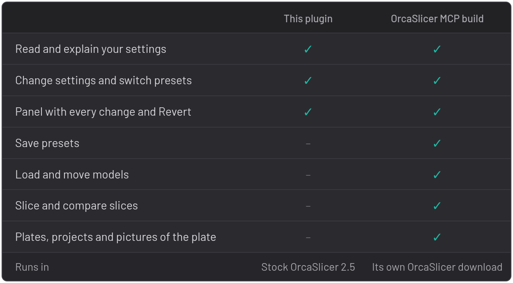

<!-- The OrcaCloud listing text (cloud.orcaslicer.com/p/16d116a6bc41). On OrcaCloud the two pictures are uploaded media. This copy follows the live text (the owner's own edits included); the Connect-your-AI-app step needs plugin 0.2.1. -->

**Work with an AI assistant to get the print you're after, and learn how OrcaSlicer gets you there. Tell it your goal. It changes the settings that matter, explains each one, and checks your printer can handle them. You talk to it in your usual AI app; the changes appear in OrcaSlicer.**

{width=50% align=left}

## Example

**You ask:** *"I designed these brackets and want them as strong as possible. Show me the changes you'd make."*

It raises the wall loops from 4 to 7, because a bracket's strength is in its walls, and the nozzle temperature from 200 to 215 °C, so each layer fuses to the next. Both changes appear beside the 3D view. Slice and see, ask why, try another idea, and press **Revert** on anything you don't want.

## What it does

- **Reads your setup.** Printer, filament and process settings, explained in plain words.
- **Changes settings and switches presets.** They show as unsaved edits, like your own. Your saved presets stay as they are until you save them.
- **Shows every change** in the OrcaSlicer MCP panel, with **Revert** or **Switch back** on each one.
- **Leaves your own edits alone.** It sees what you changed yourself, so it doesn't undo your work.
- **Reads your slices.** After you press **Slice plate**, it reads the print time, filament use and G-code, so it can tell you what each change did.

The panel sits beside the 3D view. If you close it, it comes back the next time your assistant uses OrcaSlicer. The token, the port and the off switch are in the main menu > **Plugins** > OrcaSlicer MCP > **Config**.

## Plugin or OrcaSlicer MCP build?

{width=50% align=left}

OrcaSlicer's plugin system can't do the rest. You don't need the [OrcaSlicer MCP build](https://github.com/MaxEllis/OrcaSlicer/releases/latest) for anything this plugin does.

## What you need

- An AI app on your computer that can use MCP connectors, such as **Claude Desktop**, **Claude Code**, **Codex**, **Cursor**, **VS Code** or **LM Studio**. The plugin needs no API key of its own: it works through the app you already use. Chats in a web browser and phone apps can't connect, because the plugin runs on your computer.
- The plugin or the free [orcaslicer-mcp](https://github.com/MaxEllis/orcaslicer-mcp#get-started) connector. 

## Set it up

1. **Install.** Subscribe here, then in OrcaSlicer open the main menu (the icon beside **File**) > **Plugins**, install OrcaSlicer MCP and tick **Activate**.
2. **Allow it.** OrcaSlicer asks for network access to `127.0.0.1` (this computer only), for a thread that keeps the connection open, and to read its own temporary `orcaslicer_model` folder, where each slice's G-code goes. Choose **Yes**. **No** stops the plugin.
3. **Connect your AI app.** In the plugin's **Config** tab, pick your app under **Connect your AI app** and copy what it needs, with your token already in it. Claude Desktop gets a file to open; the others get one line or a settings block. The [setup steps](https://github.com/MaxEllis/orcaslicer-mcp#get-started) have the details.
4. **Check it works.** Ask *"Which printer and filament is OrcaSlicer set up for?"*

*Prefer a file?* 
Download `orcaslicer_mcp_plugin.py` from the [latest release](https://github.com/MaxEllis/orcaslicer-mcp/releases/latest). In the Plugins window, click the arrow beside **Install plugin**, choose **Install local plugin**, click the green **Install local plugin** button, pick the file and tick **Activate**. A newer file installed later asks for the permissions again: click **Yes**, then tick **Activate**.

## Safety

- It listens on this computer only, and every request needs the token.
- It never changes post-processing scripts, custom G-code, printer connections or plugin settings.
- It hides printer passwords and API keys from the assistant.
- The only file it reads is the G-code of your last slice, in OrcaSlicer's temporary folder.
- You can pause the assistant at any time in the plugin's **Config** tab.
- The plugin itself sends nothing over the internet. What it tells your assistant goes to the model your AI app uses, as the rest of your chat does.

Source and issues: [github.com/MaxEllis/orcaslicer-mcp](https://github.com/MaxEllis/orcaslicer-mcp)
