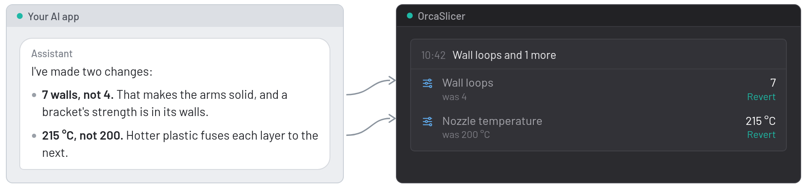

Tell your AI assistant what's going wrong with a print. It changes the OrcaSlicer settings that matter, says why, and checks your printer can handle them. You talk to it in your usual AI app; the changes appear in OrcaSlicer.

## For example

You ask: *"My PETG strings everywhere and the first layer keeps lifting at the corners. What should I change?"* It lowers the nozzle temperature, warms the bed for the first layer and lengthens the retraction, tells you why for each one, and lists them beside the 3D view, each with **Revert**. Then you slice and see.

## What it does

- Reads your printer, filament and process settings and explains what they do.
- Changes settings and switches presets. Changes show as unsaved edits, like your own: nothing is written to your saved presets unless you save them yourself.
- Lists every change in the OrcaSlicer MCP panel beside the 3D view, with **Revert** or **Switch back** on each.
- Tells the assistant what you changed yourself, so it doesn't undo your work.

It can't load models, slice or manage projects: OrcaSlicer's plugin system doesn't allow it. The [OrcaSlicer MCP build](https://github.com/MaxEllis/OrcaSlicer/releases/latest) can. You don't need it for anything above.

## What you need

- An AI app on your computer that can use MCP connectors, such as Claude Desktop, Cursor, VS Code or LM Studio. Chats in a web browser and phone apps can't connect to it, because it runs on your computer.
- The free [orcaslicer-mcp](https://github.com/MaxEllis/orcaslicer-mcp#get-started) connector. The plugin is free too.

## Set it up

1. Subscribe, then in OrcaSlicer open the main menu (the icon beside **File**) > **Plugins**, install OrcaSlicer MCP and tick **Activate**.

   Prefer a file? Download `orcaslicer_mcp_plugin.py` from the [latest release](https://github.com/MaxEllis/orcaslicer-mcp/releases/latest). In the same Plugins window, click the arrow beside **Install plugin** and choose **Install local plugin**, then click the green **Install local plugin** button again, pick the file and tick **Activate**. Installing a newer file later turns the plugin off and asks for its permissions again: click **Yes**, then tick **Activate** again.
2. OrcaSlicer shows **Plugin permissions**: network access to `127.0.0.1`, which means this computer only, and permission to create a thread, which keeps the connection running. Choose **Yes**; **No** stops the plugin.
3. Copy the token from the plugin's **Config** tab.
4. Add the connector to your AI app with that token, as its [setup steps](https://github.com/MaxEllis/orcaslicer-mcp#get-started) show. Then ask *"Which printer and filament is OrcaSlicer set up for?"* to check it works.

It listens on this computer only, needs the token for every request, and never touches scripts, custom G-code or printer connections. Turn it off any time in the Config tab.

Source and issues: [github.com/MaxEllis/orcaslicer-mcp](https://github.com/MaxEllis/orcaslicer-mcp)
